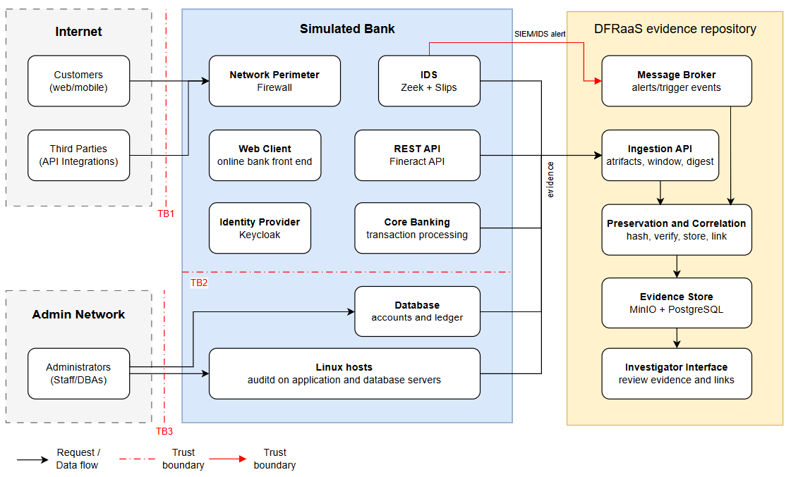

# DFRPOBS: Digital Forensic Readiness for Online Banking Systems

Source code, testbed and evaluation data for the COS700 Honours research project
**"Design and Evaluation of a Digital Forensic Readiness Framework for Online Banking Platforms"**
(University of Pretoria, BSc Honours).

## Overview

Forensic investigation at banks is usually reactive: evidence is only gathered after an
incident is detected, and by then the records that would explain it may already be
overwritten, altered or never collected. This project designs a digital forensic readiness
(DFR) framework for South African online banking platforms, builds part of it, and
evaluates it. The framework collects, preserves and correlates evidence *before* anyone
needs it.

The framework follows the Design Science Research Methodology, aligns with ISO/IEC 27043,
and adapts two existing models:

- **K-FFRaaS** for the process view: readiness comes before investigation, and evidence is classified by *work group*.
- **SecureRS** for storage engineering: hash evidence on arrival, verify it on access, and gate its release.

Its central principle is **continuous collection with retrospective correlation**. Evidence
is preserved as soon as it arrives. An IDS alert does not trigger collection; it acts as an
anchor for retrieving evidence that was already preserved around it.

## Repository layout

| Directory | Contents |
|---|---|
| [`Evidence Repository/`](Evidence%20Repository/README.md) | **DFRaaS**, the prototype evidence repository. Spring Boot (Java 21) backend, React + Vite frontend, PostgreSQL, MinIO and Redpanda/Kafka. It hashes evidence on ingest, keeps a hash-chained chain-of-custody ledger, groups alerts into incidents and proposes evidence links for an investigator to review. |
| [`PDE Sources/`](PDE%20Sources/README.md) | The testbed: simulators for the Potential Digital Evidence sources (ufw firewall, Slips IDS, Apache Fineract banking events and audit trail), the `pde` console that drives them, and scripts that submit captured evidence to the repository. |
| [`PDE Sources/evaluation/`](PDE%20Sources/evaluation/README.md) | The 24 captured evaluation windows, the replay, correlation and tamper-test scripts, and their results. |
| [`Fineract/`](Fineract/README.md) | Docker setup, seeding scripts, workarounds and a Kafka listener for the Apache Fineract core banking platform used as the simulated bank. |
| [`Anomaly Detection/`](Anomaly%20Detection/Slips_Setup.md) | Setup notes and helper scripts for running the Slips network IDS. |

## Architecture



*Simplified online banking architecture used as the operational context for the framework,
showing trust boundaries and evidence flows.*


## Getting started

Each component has its own README with full instructions. In brief:

**Evidence Repository** (needs Docker, Java 21 and Node.js):

```bash
cd "Evidence Repository"
docker compose up -d                       # Postgres, MinIO, Redpanda
cd backend && ./mvnw spring-boot:run       # API on :8080
cd ../frontend && npm install && npm run dev   # UI on :5173
```

`./mvnw test` runs the backend tests against Testcontainers and does not need the stack running.

**PDE testbed** (needs Linux or WSL2, sudo, Docker; see the [PDE Sources README](PDE%20Sources/README.md)
for the full list of requirements and how to run with or without the cloud VM):

```bash
cd "PDE Sources"
sudo ./lab.sh up --with-ids --local-bank
sudo Firewall/simulate-firewall.sh --attack-profile port-scan --seed 1001
sudo ./lab.sh down
```

**Reproducing the evaluation**: the captured windows and scripts are in
[`PDE Sources/evaluation/`](PDE%20Sources/evaluation/README.md). `replay_into_repository.py`
submits the windows and replays the Slips alerts into a running repository,
`check_correlation.py` scores the correlation, and `tamper_tests.py` runs the integrity tests.

## Evaluation summary

The framework was evaluated in a simulated bank built from real banking, firewall and
intrusion detection software. There were 24 thirty-second windows: 7 attack profiles plus a
benign baseline, each run with 3 seeds.

- Continuous collection captured evidence of the fraud in **all 21 attack windows**. The IDS alerted in only **6**, so alert-driven collection would have preserved fewer than a third of them.
- All **96 of 96** evidence files were preserved exactly as captured, with the repository digest matching the capture digest.
- Tampering with custody records was detected. Truncation of a record was not.
- On a digital forensic maturity model, the technical sub-domains rose to *Intermediate*. Organisational maturity is beyond what a technical artefact can supply on its own.

## Scope and limitations

- This is a research prototype. It has not been evaluated in a production banking environment.
- The evaluation replays captured windows. It does not run as a live, continuous pipeline.
- The [Evidence Repository README](Evidence%20Repository/README.md#status) lists the
  out-of-scope items, including step-up MFA, encryption at rest, a user/role model and
  manual preservation.

## Compliance context

Work groups are mapped to the South African regulatory frameworks that determine whether
evidence is admissible and handled lawfully: **POPIA**, the **ECT Act**, **Joint Standard 2 of 2024**
and **PCI DSS**.

## Authors

- Amadeus Fidos (u22526162)
- Dean Ramsay (u22599012)
- Aidan McKenzie (u23545080)
- Lubabalo Tshikila (u22644106)

**Supervisors:** Mr. SM (Sheunesu) Makura and Catherina Ackerman
Department of Computer Science, University of Pretoria
